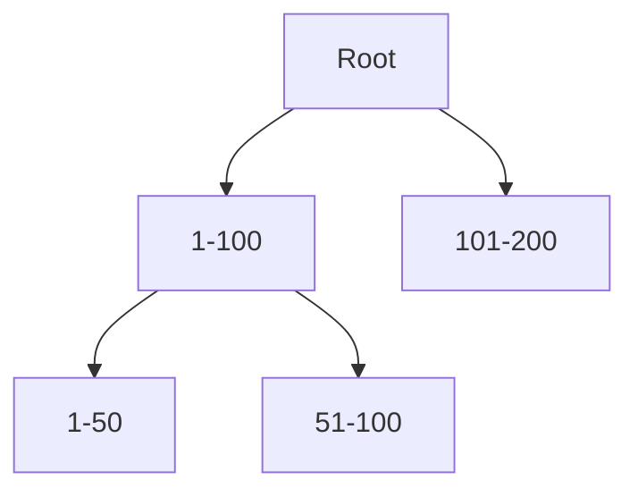

# B-Trees

**Definition:** The classic storage structure that breaks the database into fixed-size pages organized as a tree, so any page can be looked up in O(log n) via a small number of page reads.

**Why it matters:** The default indexing structure in most relational databases, offering strong read performance and mature transactional support.

**Example:**

Any key is found in a handful of page reads, following the tree down.

**Related:** [[LSM-Trees]] [[Write-Ahead Log]] [[B-Tree vs LSM-Tree]]
