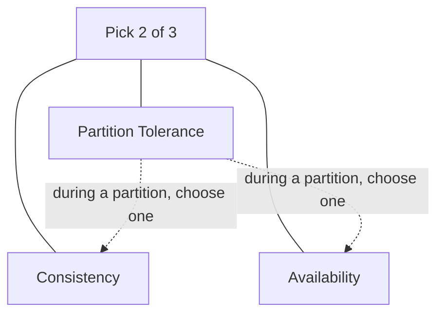

# CAP Theorem

**Definition:** States that a distributed system can provide at most two of Consistency, Availability, and Partition tolerance, but since partitions will happen, the real choice during one is between consistency and availability.

**Why it matters:** Often oversimplified or misquoted; the book is critical of how much weight it's given, preferring to reason directly about linearizability vs availability tradeoffs.

**Example:**

During an actual network partition you can pick at most Consistency or Availability — not both.

**Related:** [[Linearizability]] [[Network Faults]]
