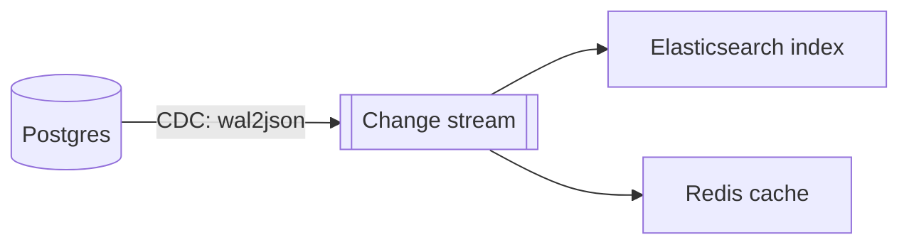

# Change Data Capture

**Definition:** The process of capturing every write to a database (inserts, updates, deletes) and exposing it as a stream of change events that other systems can consume.

**Why it matters:** Lets derived data systems (search indexes, caches, analytics) stay reliably in sync with a system of record without dual writes.

**Example:**

**Related:** [[Log-Based Message Brokers]] [[Event Sourcing]]
