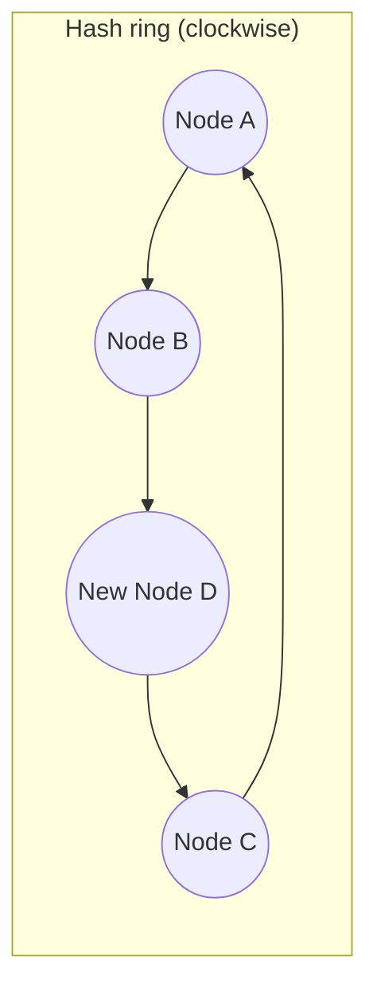

# Consistent Hashing

**Definition:** A hashing scheme where adding or removing a node only requires moving a small, bounded fraction of keys instead of reshuffling almost everything.

**Why it matters:** Minimizes data movement during rebalancing, which is critical as a cluster grows or shrinks.

**Example:**

Only the keys between D's position and the next node clockwise move to D — every other node's keys stay put.

**Related:** [[Hash Partitioning]] [[Rebalancing Partitions]]
