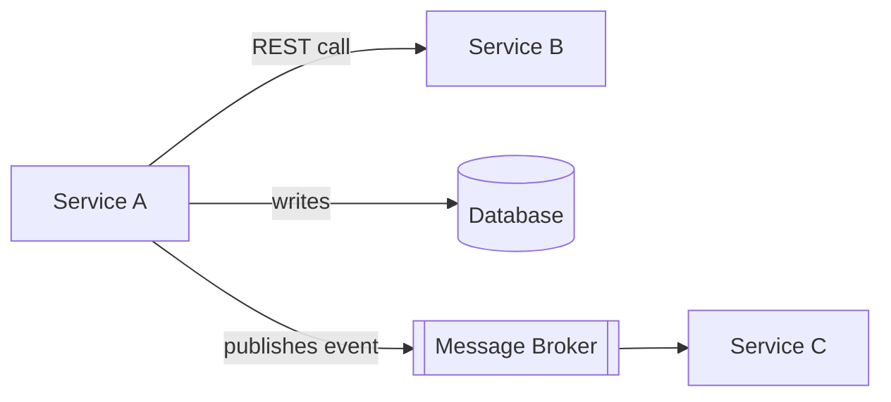

# Dataflow Through Databases Services and Messaging

**Definition:** The three main ways data flows between processes: through databases, through RPC/REST services, and through asynchronous message passing via message brokers.

**Why it matters:** Each dataflow mode has different implications for how schema changes propagate and what compatibility guarantees are needed.

**Example:**

**Related:** [[Schema Evolution]] [[Message Brokers]]
