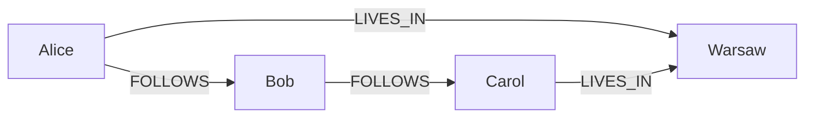

# Graph Data Model

**Definition:** Data modeled as vertices (entities) and edges (relationships), suited to highly interconnected data with many many-to-many relationships, queried via languages like Cypher.

**Why it matters:** Relational and document models struggle to express complex, evolving many-to-many relationships; graph models make that natural.

**Example:**

**Related:** [[Relational Model]] [[Document Model]]
