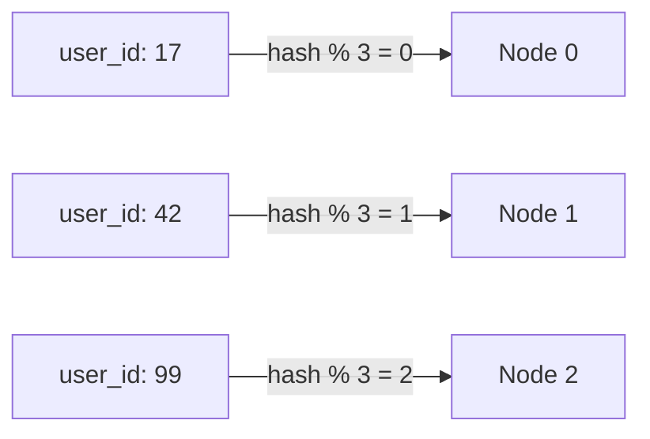

# Hash Partitioning

**Definition:** Assigning partitions based on a hash of the key, spreading keys pseudo-randomly across partitions.

**Why it matters:** Distributes load evenly and avoids hot spots, but sacrifices the ability to do efficient range queries.

**Example:**

`hash(user_id) % 3` sends roughly equal traffic to each of 3 nodes, but makes "find all users between IDs 100-200" impossible to answer from one partition.

**Related:** [[Partitioning]] [[Consistent Hashing]]
