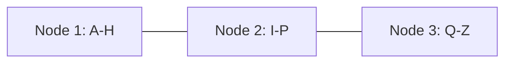

# Key Range Partitioning

**Definition:** Assigning each partition a continuous range of keys (like the volumes of an encyclopedia), keeping keys sorted within a partition.

**Why it matters:** Makes range queries efficient, but risks hot spots if certain key ranges (e.g. today's timestamp) are written far more than others.

**Example:**

`[A-H] -> Node1, [I-P] -> Node2, [Q-Z] -> Node3` — but if everyone's key starts with today's date, one partition gets all the traffic.

**Related:** [[Partitioning]] [[Rebalancing Partitions]]
