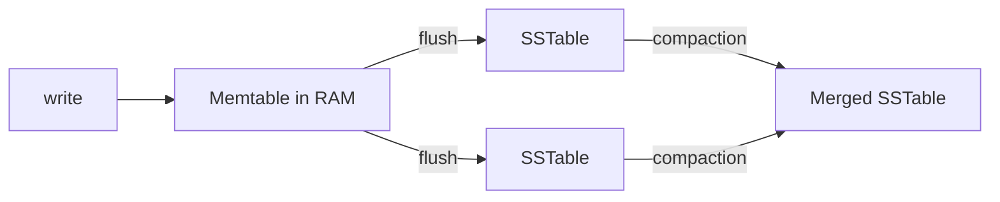

# LSM-Trees

**Definition:** Log-Structured Merge-Trees: storage engines that buffer writes in an in-memory structure (memtable), periodically flush to sorted SSTables on disk, and merge/compact them in the background.

**Why it matters:** Give very high write throughput, which is why they underlie Cassandra, RocksDB, LevelDB, and HBase.

**Example:**

**Related:** [[SSTables]] [[B-Trees]] [[Compaction]] [[B-Tree vs LSM-Tree]]
