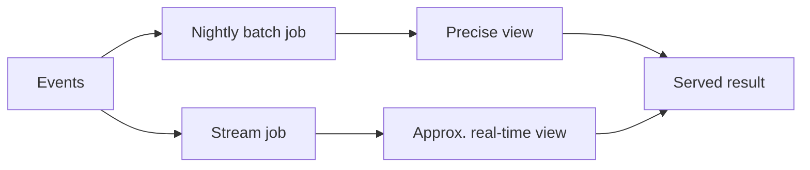

# Lambda Architecture

**Definition:** An architecture running the same logic as both a batch job (for complete, periodically recomputed correctness) and a stream job (for low-latency approximate results), merging their outputs.

**Why it matters:** A pragmatic early pattern for combining accuracy with low latency, though it has the downside of duplicating application logic across two systems.

**Example:**

**Related:** [[MapReduce]] [[Stream Processing Windows]]
