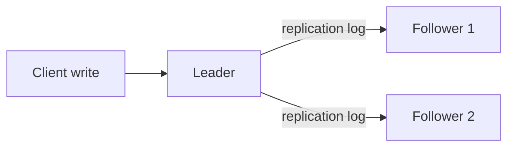

# Leader-Based Replication

**Definition:** One replica (the leader) accepts all writes and streams a replication log to follower replicas, which apply writes in the same order.

**Why it matters:** The most common replication approach (used by PostgreSQL, MySQL, MongoDB) because it avoids write conflicts by funneling all writes through one node.

**Example:**

**Related:** [[Synchronous vs Asynchronous Replication]] [[Replication Lag]] [[Replication Strategies]]
