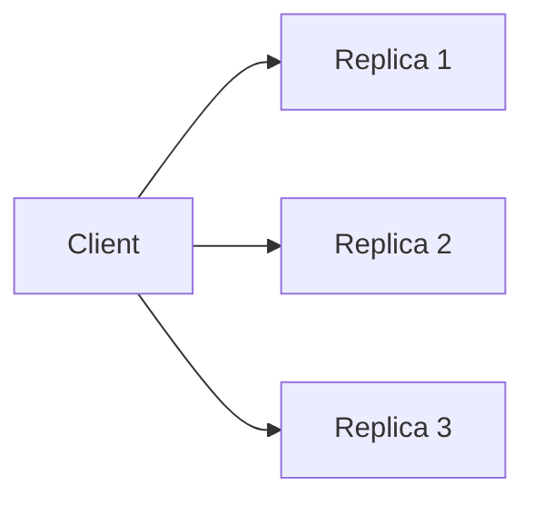

# Leaderless Replication

**Definition:** Any replica can accept writes directly from clients, which send writes and reads to several replicas in parallel, as in Dynamo-style systems like Cassandra and Riak.

**Why it matters:** Removes the leader as a single point of failure, trading it for the need for quorum reads/writes and conflict resolution.

**Example:**

**Related:** [[Quorum Reads and Writes]] [[Conflict Resolution]] [[Replication Strategies]]
