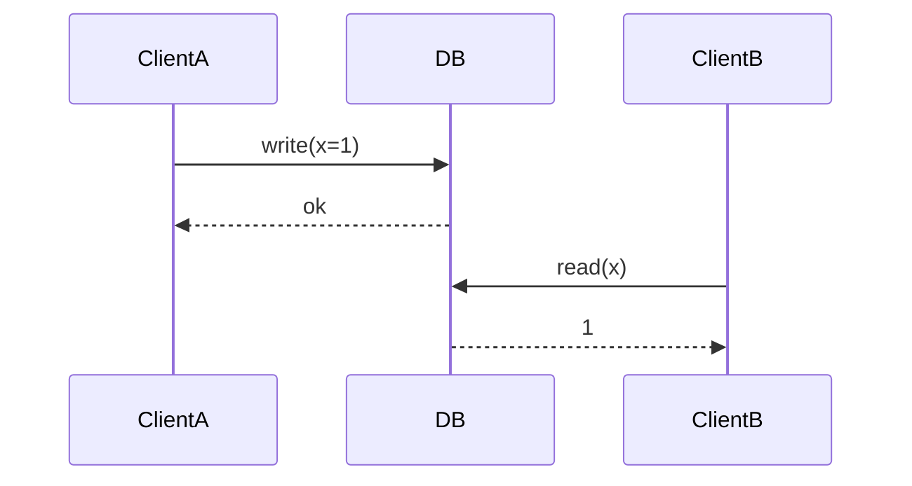

# Linearizability

**Definition:** A consistency guarantee making a system behave as if there were only a single copy of the data, so once a write completes, all subsequent reads by any client see that value or a later one.

**Why it matters:** A strong, intuitive recency guarantee needed for things like locks and uniqueness constraints, but it comes at a real performance and availability cost.

**Example:**

Once A's write returns, every later read, by anyone, must see 1 or newer — never the old value.

**Related:** [[Quorum Reads and Writes]] [[CAP Theorem]]
