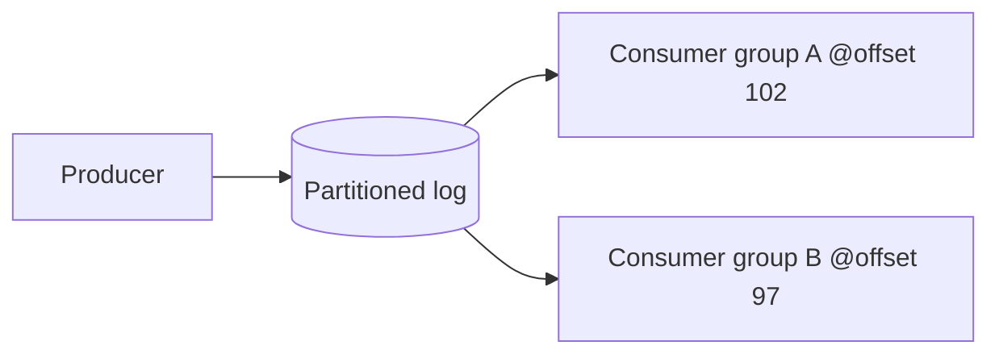

# Log-Based Message Brokers

**Definition:** Brokers (e.g. Apache Kafka) that durably append messages to a partitioned log, letting multiple consumers independently track their own read position and replay old messages.

**Why it matters:** Combines the durability of a database log with the pub/sub pattern of a message broker, central to building scalable stream-processing pipelines.

**Example:**

**Related:** [[Message Brokers]] [[Change Data Capture]]
