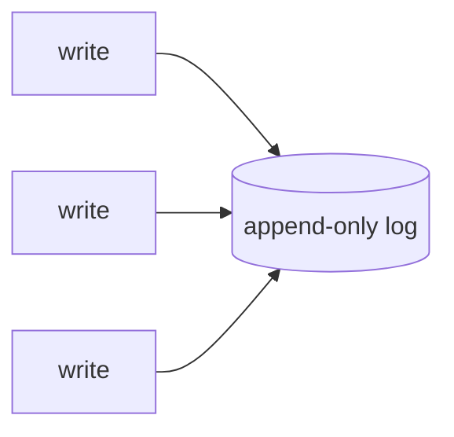

# Log-Structured Storage

**Definition:** Storage engines that only ever append to files (a log) rather than updating data in place, relying on background compaction to reclaim space.

**Why it matters:** Sequential writes are much faster than random writes on both spinning disks and SSDs, which is the basis for LSM-trees.

**Example:**

Every write is appended; nothing is ever edited in place.

**Related:** [[SSTables]] [[LSM-Trees]] [[Compaction]]
