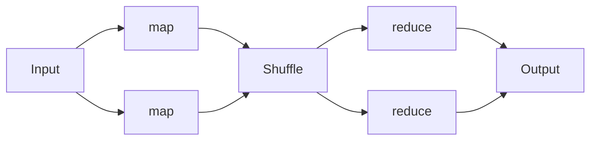

# MapReduce

**Definition:** A batch processing framework that runs a map function over input records (emitting key-value pairs) and a reduce function that aggregates values sharing a key, with sorting and shuffling in between.

**Why it matters:** Popularized distributed batch processing on commodity hardware (Hadoop), though largely superseded in practice by more flexible dataflow engines.

**Example:**

**Related:** [[Distributed Filesystems]] [[Join Algorithms]]
