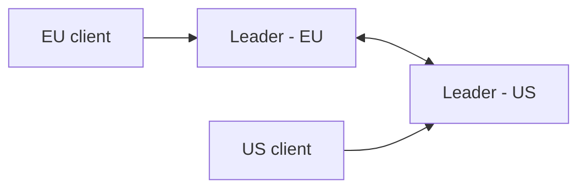

# Multi-Leader Replication

**Definition:** Multiple nodes can each accept writes and replicate them to each other, often used across multiple datacenters.

**Why it matters:** Allows every datacenter to keep operating during a network partition between regions, at the cost of having to handle write conflicts.

**Example:**

**Related:** [[Conflict Resolution]] [[Leader-Based Replication]] [[Replication Strategies]]
