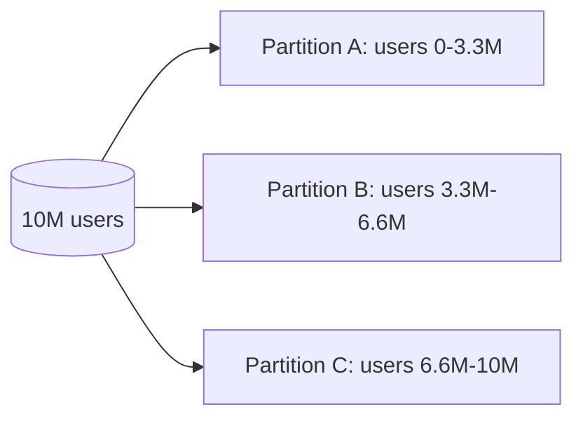

# Partitioning

**Definition:** Splitting a large dataset into smaller partitions (shards), each held on a different node, so different partitions can be read and written in parallel.

**Why it matters:** Necessary for scalability when a dataset or query load is too large for a single machine.

**Example:**

**Related:** [[Key Range Partitioning]] [[Hash Partitioning]]
