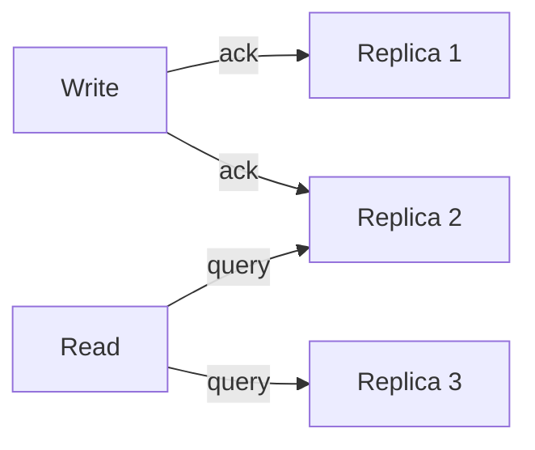

# Quorum Reads and Writes

**Definition:** Requiring writes to succeed on at least w replicas and reads to query at least r replicas, where w + r > n (total replicas), to make reads see the latest write.

**Why it matters:** Lets leaderless systems tolerate node failures while still getting (probabilistically) up-to-date reads.

**Example:**

With n=3 replicas, w=2, r=2: the write reaches R1+R2, the read queries R2+R3 — R2 overlaps, so the read is guaranteed to see the latest write.

**Related:** [[Leaderless Replication]] [[Linearizability]]
