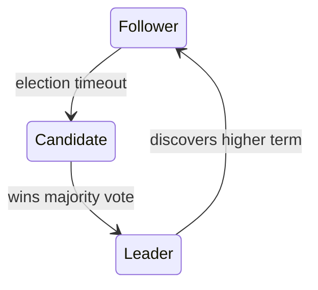

# Raft

**Definition:** A consensus algorithm designed to be more understandable than Paxos, built around strong leader election and a replicated log.

**Why it matters:** Widely adopted in real systems (etcd, Consul, CockroachDB) because its leader-based design is easier to reason about and implement.

**Example:**

**Related:** [[Consensus]] [[Paxos]] [[Paxos vs Raft]]
