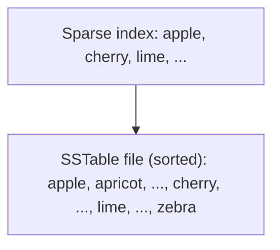

# SSTables

**Definition:** Sorted String Tables: an on-disk file format storing key-value pairs sorted by key, enabling efficient merging, range queries, and sparse in-memory indexes.

**Why it matters:** The core persisted file format underlying LSM-tree storage engines like LevelDB and Cassandra.

**Example:**

A 100MB SSTable file holding keys `"apple"..."zebra"` sorted alphabetically, with a sparse index pointing to every 64th key for fast lookups.

**Related:** [[LSM-Trees]] [[Log-Structured Storage]]
