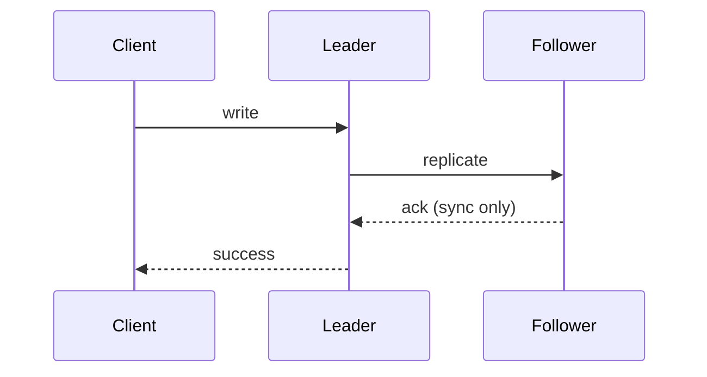

# Synchronous vs Asynchronous Replication

**Definition:** Synchronous replication means the leader waits for a follower to confirm before reporting a write as successful; asynchronous means it doesn't wait.

**Why it matters:** Synchronous gives a stronger durability guarantee but risks blocking writes if a follower is slow; most systems use semi-synchronous or fully async replication.

**Example:**

**Related:** [[Leader-Based Replication]] [[Replication Lag]]
