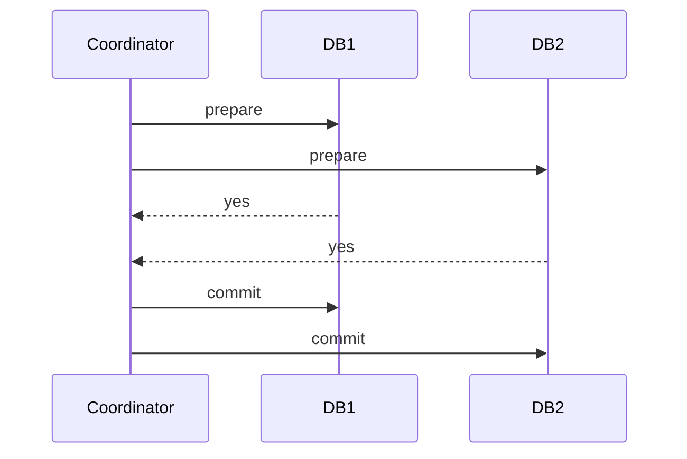

# Two-Phase Commit

**Definition:** An atomic commit protocol where a coordinator first asks all participants to prepare (promise they can commit), and only tells them to actually commit if all agree.

**Why it matters:** The standard way to achieve atomicity across multiple nodes or databases, but it blocks if the coordinator fails mid-protocol.

**Example:**

**Related:** [[Atomicity]] [[Consensus]]
