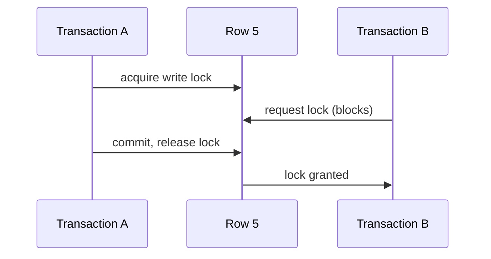

# Two-Phase Locking

**Definition:** A concurrency control technique (distinct from two-phase commit) where transactions acquire shared or exclusive locks on objects they access and hold them until the transaction ends.

**Why it matters:** One of the oldest and most common ways to achieve true serializable isolation, at the cost of reduced concurrency and risk of deadlock.

**Example:**

Transaction A holds a write lock on row 5 until it commits; any other transaction trying to read or write row 5 simply blocks until A finishes.

**Related:** [[Serializability]] [[Isolation Levels]]
