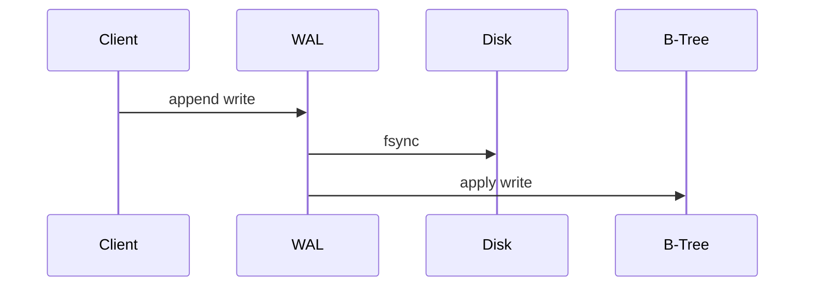

# Write-Ahead Log

**Definition:** An append-only log to which every modification is written before being applied to the main data structures, used to recover from crashes.

**Why it matters:** Makes B-tree indexes resilient to crashes; without it, a half-written page could corrupt the index.

**Example:**

If the process crashes after the fsync but before applying to the tree, recovery just replays the WAL.

**Related:** [[B-Trees]] [[Reliability]]
