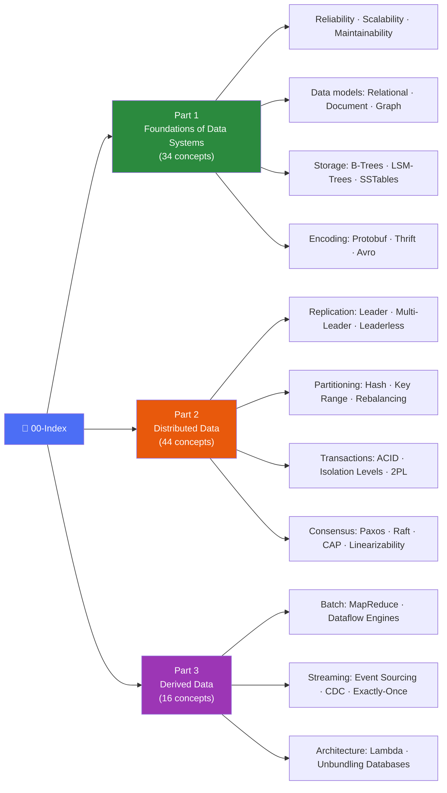

# DDIA — Designing Data-Intensive Applications Notes

An [Obsidian](https://obsidian.md) vault of notes on Martin Kleppmann's *Designing Data-Intensive Applications*. Every concept gets its own note, linked back to the book part it belongs to, so the whole thing doubles as a personal knowledge graph of the book.

## Structure

| Part | Topic | Concepts |
|---|---|---|
| [Part 1](<Part 1 - Foundations of Data Systems.md>) | Foundations of Data Systems | 34 |
| [Part 2](<Part 2 - Distributed Data.md>) | Distributed Data | 44 |
| [Part 3](<Part 3 - Derived Data.md>) | Derived Data | 16 |

Each part note is a map of content (MOC) linking out to the individual concept notes in [`Concepts/`](Concepts). Every concept note follows the same [template](<Templates/Concept Template.md>): definition, why it matters, related concepts, and book location.

Start at [`00-Index.md`](00-Index.md).

## Usage

Clone the repo and open the folder as a vault in Obsidian to get clickable `[[wikilinks]]` and the graph view. The notes also render fine as plain Markdown on GitHub.
